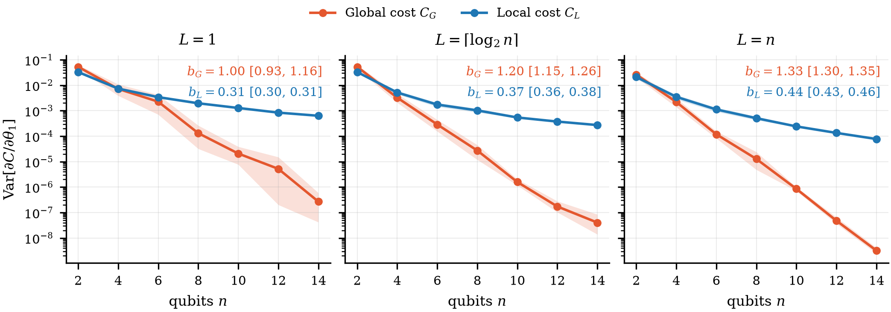
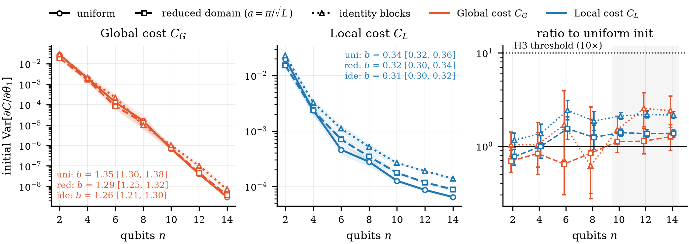
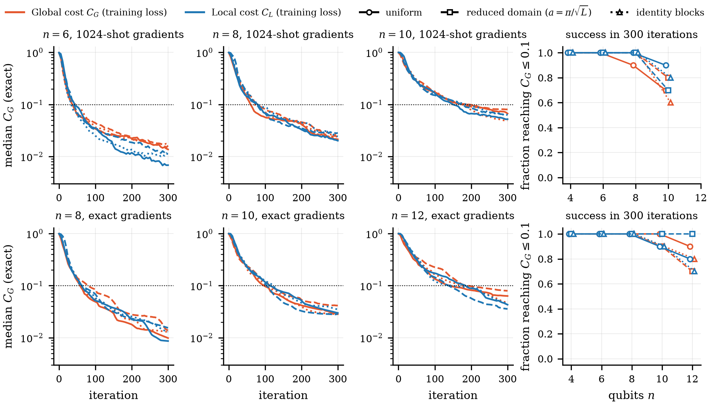
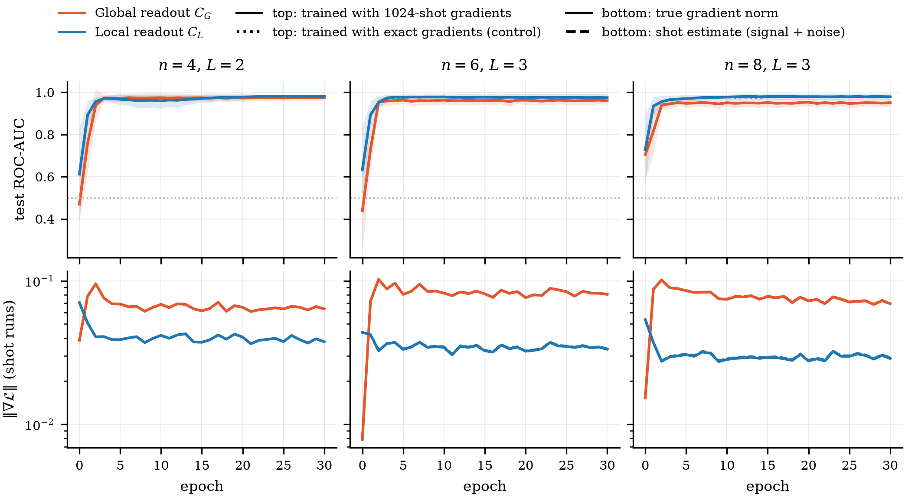
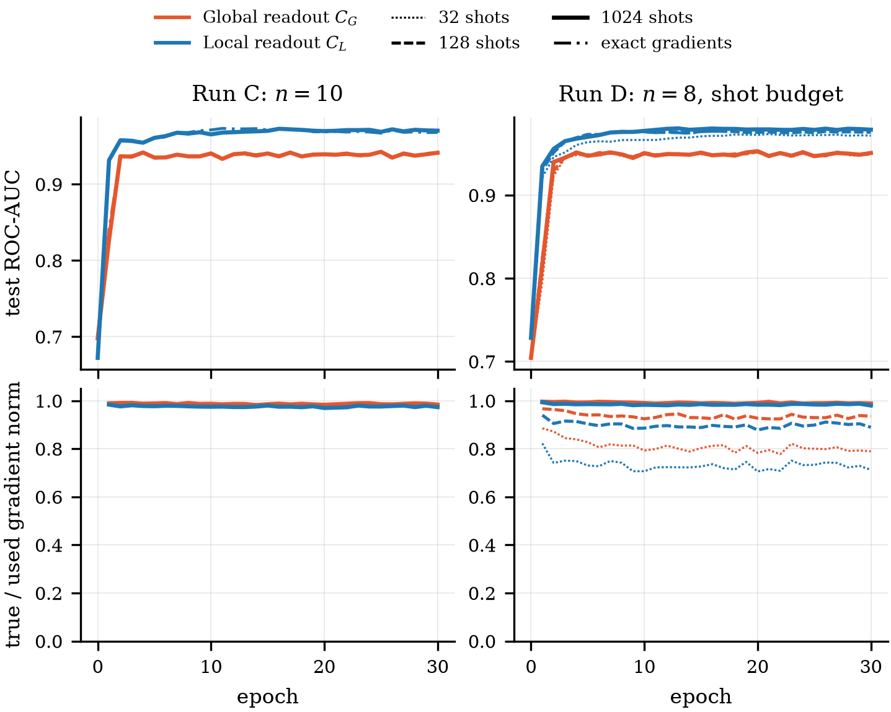
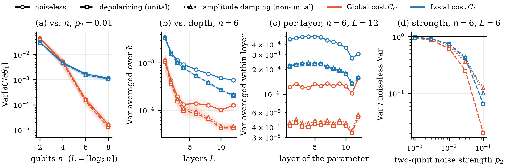
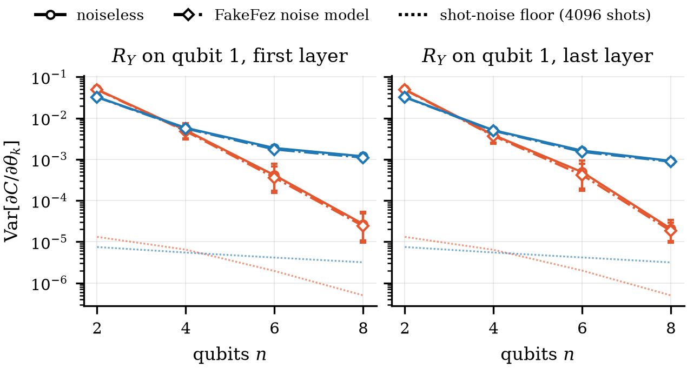

# Project overview: Barren Plateaus, Global vs. Local Cost Functions

AI 631 Quantum Machine Learning, Fall 2026, Project #8 (QNN track) · Saif ur Rehman
Status as of **22 Nov 2026** (end of Week 2; all simulations complete)

This page explains the whole project in plain terms and collects every result so
far. The technical write-up is the IEEE report (`report/report.tex`). Week-by-week
number tables are in `results/week1_summary.md` and `results/week2_summary.md`.

---

## 1. The idea in plain terms

**Quantum neural networks.** A quantum neural network is a quantum circuit with
adjustable knobs (rotation angles). It is trained like an ordinary neural network:
measure how wrong it is (the *cost*), work out which way to turn each knob (the
*gradient*), and nudge the knobs a little. Repeat.

**The problem: barren plateaus.** For many circuits, the cost landscape becomes
almost perfectly flat as qubits are added. It is like looking for the bottom of a
valley while standing on a huge, flat plain: every direction looks the same. The
gradients shrink *exponentially* with the number of qubits, so training stalls. On
a real quantum computer, measuring such a tiny gradient would need an enormous
number of repeated measurements (shots).

**Our question: does the way we score the circuit matter?** We compare two costs
that ask for the same thing (put every qubit in state 0) but score it differently:

| | Plain-language analogy | Formula |
|---|---|---|
| **Global cost** C_G | One pass/fail grade for the whole exam: are *all* qubits right at once? | `C_G = 1 − P(all qubits = 0)` |
| **Local cost** C_L | Partial credit per question: *on average*, how many qubits are right? | `C_L = 1 − (1/n) Σ_j P(qubit j = 0)` |

Theory (Cerezo et al., 2021) predicts that the global cost goes flat very fast as
qubits are added, while the local cost stays trainable much longer for shallow
circuits. The proofs need idealized assumptions, so we test the prediction
**empirically** on a realistic "hardware-efficient" circuit. We then follow it
through to real training tasks, noise, and (in Week 3) a real IBM quantum computer.

Both costs come from the *same* measurement, so any difference is caused only by
how the result is scored.

---

## 2. The four hypotheses (pre-registered in the synopsis)

| | Hypothesis | It counts as **false** if… |
|---|---|---|
| **H1** | At shallow depth (L = ⌈log₂ n⌉) the global cost's gradients vanish exponentially, while the local cost's vanish much more slowly. | the fitted decay rates overlap, or the two differ by less than 10× at 14 qubits |
| **H2** | Deeper circuits (L ∝ n) make the local cost flatten faster too. | its decay rate does not increase with depth |
| **H3** | A smarter starting point (identity blocks or small angles) rescues the global cost. | at n ≥ 10, neither raises the starting gradient variance by ≥ 10×, *or* neither speeds up training |
| **H4** | A real classifier learns more slowly through a global readout than through a local one, and the gap grows with n. | the test curves are within one standard deviation of each other at the largest n |

Negative results are reported as such.

---

## 3. What we built

* **A small, verified quantum simulator** (`src/bp/sim.py`) that computes *exact*
  gradients of every knob in one forward and one backward pass. It is checked
  against Qiskit, finite differences, the parameter-shift rule and a closed-form
  formula (51 automated tests).
* **A noisy (density-matrix) simulator** (`src/bp/density.py`, new in Week 2) with
  depolarizing and amplitude-damping noise and exact gradients. It matches Qiskit
  Aer to 10⁻¹² and finite differences.
* **An identity-block circuit** (`ib_hea`, new in Week 2). Identity-block
  initialization needs a circuit built as "block, then its mirror image". A naive
  mirror makes neighbouring entangling (CZ) layers cancel, and the circuit quietly
  stops entangling anything. We caught that bug and designed the circuit so the
  CZ layers survive. A test guards against it.
* **A leakage-free classification benchmark** on the Breast Cancer Wisconsin data
  (fixed 5-fold split, PCA to n features fitted on training data only) with
  matched classical baselines.
* **IBM device noise model**: Qiskit Aer with the calibrated noise of `FakeFez`
  (IBM Heron r2), as a preview of the Week 3 hardware run.

---

## 4. Results so far

### H1: global vs. local cost ✅ supported



* At 14 qubits and L = ⌈log₂ n⌉, the global-cost gradient variance is
  **4.0 × 10⁻⁸**, while the local cost's is **2.7 × 10⁻⁴**, about **6800× larger**.
* Fitted decay rate (log Var = a − b·n, n = 4…14): **b_G = 1.17** vs. **b_L = 0.29**.
* In plain terms: every 2 extra qubits make the global gradient ~10× smaller, but
  the local gradient only ~1.8× smaller.

### H2: depth also hurts the local cost ✅ supported

* Going from L = ⌈log₂ n⌉ to L = n raises the local decay rate from **0.29 to
  0.37** (global: 1.17 → 1.33, approaching the theoretical worst case ln 4 ≈ 1.39).
* So the local cost's advantage is real but shrinks in deep circuits, as theory
  predicts.

> **Correction (Week 2):** the Week-1 fits accidentally included n = 2, while the
> synopsis pre-registered n = 4…14. The values above are the corrected fits. The
> Week-1 values (b_G = 1.20 [1.15, 1.26], b_L = 0.37 [0.36, 0.38]) lead to the same
> conclusions.

### H3: smarter starting points ❌ not supported (neither criterion met)



Task: the circuit must learn to undo a random "teacher" circuit, mapping a
scrambled state back to all-zeros. The task is always solvable, and starting
from "do nothing" (the identity) is not already the answer.

| Starting point | Global decay rate b | Starting variance vs. uniform at n ≥ 10 |
|---|---|---|
| Uniform random angles | 1.35 [1.30, 1.38] | 1× (reference) |
| Reduced domain (small angles, a = π/√L) | 1.29 [1.25, 1.32] | 1.1–1.3× (not significant) |
| Identity blocks | 1.26 [1.21, 1.30] | 1.5–2.5× (best upper bound 3.7×) |

* **Neither scheme gets anywhere near the pre-registered 10×.** The global cost
  still collapses exponentially from every starting point.
* **Why:** starting at "do nothing" avoids a random *circuit*, but the *target*
  is still far away. The overlap with a random target is itself exponentially
  small, so the global gradient is too.
* The local cost gains a steady ~2× from identity blocks, but it was never in
  trouble.
* **Ablation:** narrowing the small-angle range to π/(4√L) only raises the gain to
  ~1.9× (`figures/init_reduced_width.png`).
**Do they train faster? No.**



We trained every combination: 10 seeds, 4–12 qubits, global or local cost,
1024-shot or exact gradients, 300 Adam steps. Success means reaching C_G ≤ 0.1
(fidelity ≥ 0.9).

| 10 qubits, 1024-shot gradients | uniform | reduced | identity |
|---|---|---|---|
| global cost: seeds reaching the target | 7/10 | 8/10 | 6/10 |
| global cost: median steps to target | 184 | 170 | 166 |
| local cost: seeds reaching the target | 9/10 | 7/10 | 8/10 |
| local cost: median steps to target | 149 | 174 | 174 |

* Every difference is well within the seed-to-seed scatter (all p ≥ 0.36,
  including the 12-qubit exact runs). Identity blocks never succeed more often
  than uniform. **H3 is not supported on either criterion.**
* A 2× larger starting variance only means a √2 ≈ 1.4× larger gradient, and the
  Adam optimizer rescales gradient sizes anyway, so this was expected.
* **Surprise:** at these sizes the global cost trains as well as the local one,
  even with realistic 1024-shot gradients and a 22× smaller starting gradient.
  (An early one-seed pilot had suggested the global cost barely moves under shot
  noise. The full 10-seed run shows that was just the first few steps.) The
  reason: when P(all zeros) is tiny, its *measurement noise* is tiny as well.
  At 10 qubits the noise and the signal are about the same size, which is just
  enough to train. Shot noise does slow training by about 1.6× and costs some
  seeds (success 93% → 70% for global, 80% for local). A rough extrapolation
  suggests the global cost would stall at about 12+ qubits with 1024 shots. We
  have not tested this.

### H4: does the classifier care? ⚠️ there is a gap, but it isn't a plateau effect



* With exact gradients, both readouts reach a similar test ROC-AUC (global
  0.976 → 0.948, local 0.978 → 0.962 for 4 → 10 qubits). All quantum models stay
  below the classical baselines (logistic regression, SVM and a matched MLP, all
  ≈ 0.99).
* With realistic 1024-shot gradients (4–8 qubits), the global readout starts with
  a 2–5× smaller gradient, but there is enough signal to train. Shot-trained and
  exact-trained models end up identical. **No plateau effect at this size.**
**Week 2: 10 qubits (Run C), and 8 qubits with only 32 or 128 shots (Run D)**



| | global readout | local readout | gap (local − global) |
|---|---|---|---|
| 10 qubits, 1024-shot gradients | 0.941 ± 0.019 | 0.970 ± 0.017 | **+0.029** [0.016, 0.042] |
| 10 qubits, exact gradients | 0.942 ± 0.019 | 0.968 ± 0.019 | +0.026 [0.011, 0.042] |
| 8 qubits, 32 shots | 0.951 ± 0.020 | 0.972 ± 0.025 | +0.020 |
| 8 qubits, 128 shots | 0.950 ± 0.019 | 0.976 ± 0.015 | +0.026 |
| 8 qubits, 1024 shots (Run B) | 0.951 ± 0.020 | 0.979 ± 0.014 | +0.028 |

(Test ROC-AUC, mean ± s.d. over 5 folds × 3 seeds; the gap uses paired fold/seed
differences with a 95% bootstrap interval.)

* **By the letter of the pre-registered test, H4 survives.** At 10 qubits the
  local readout beats the global one by more than one standard deviation, and the
  gap grows from 4 to 8 qubits (+0.007 → +0.015 → +0.028), then levels off.
* **But the gap isn't caused by a barren plateau:**
  1. It is just as large with **exact** gradients (no measurement noise at all).
  2. The global readout does **not learn more slowly**. Both readouts reach 95% of
     their final score within 2–4 epochs; the global one just ends lower.
  3. Cutting the shots 32× barely changes either readout. Even at 32 shots, the
     global readout keeps *more* of its gradient signal (81%) than the local one
     (73%), for the same reason as in H3.
* **Conclusion:** the global readout gives the classifier a less useful function to
  learn with. The gap is a difference in model capacity, not in trainability. At
  10 qubits, 1024 shots still capture 98–99% of the gradient signal.

### Noise: cost choice matters more than noise (at our sizes)



* **(a)** At shallow depth, realistic noise (1% per two-qubit gate) lowers the
  gradient variance by **at most 20%**. The global/local gap is orders of
  magnitude bigger, so **the plateau comes from the cost, not the noise.**
* **(b)** Noise matters in **deep** circuits. Without noise the variance levels
  off with depth; with noise it keeps falling. At 12 layers depolarizing noise
  has removed **67%** (global) and **53%** (local) of the variance. This is the
  "noise-induced barren plateau".
* **(d)** The two noise types only differ when noise is strong. At 10% noise,
  amplitude damping keeps 12% of the global variance vs. 2% for depolarizing,
  because damping pushes qubits towards 0, which is exactly the global cost's
  target.
* We did *not* see a predicted effect where only the last layers keep their
  gradients under non-unital noise (Mele et al., 2026). That needs deeper, noisier
  circuits than we ran.

### IBM device noise model: the Week 3 hardware test should work



* With IBM's calibrated `FakeFez` noise (gate errors, decoherence, readout errors),
  the gradient variances stay within **15%** of the noiseless values up to 8 qubits.
* The extra variance from 4096-shot measurement (dotted lines) is **36–4300×
  smaller** than the signal, and **≥ 180×** smaller at the hardware sizes we plan
  (2, 4, 6 qubits). So a real-device run should clearly resolve the global/local
  gap. The limit will be the number of random draws we can afford, not the shot
  noise.

### Scorecard

| | Verdict so far |
|---|---|
| **H1** | ✅ Supported (6800× gap at 14 qubits) |
| **H2** | ✅ Supported (local decay 0.29 → 0.37 with depth) |
| **H3** | ❌ Not supported: variance gain ≤ 2.5× (needed 10×), and no faster training |
| **H4** | ⚠️ Pre-registered test passed (+0.029 AUC gap at 10 qubits), but the gap also appears without shot noise and both readouts learn equally fast: a capacity effect, not a plateau |

---

## 5. Timeline and status

| Due | Milestone | Status |
|---|---|---|
| Nov 8 | Synopsis | ✅ |
| Nov 15 | Week 1: tools, data pipeline, baselines, first quantum model | ✅ (branch `week1`) |
| **Nov 22** | **Week 2: full simulations, initializations, training task, noise, ablations, results draft** | ✅ (branch `week2`) |
| Nov 29 | Week 3: IBM quantum hardware, 2/4/6 qubits, ~300 circuits | Next. Needs an IBM Quantum API key (free plan: 10 min/month is enough) |
| Dec 6 | Final report, presentation, tagged release | — |

**Where things run:** all simulations run on the laptop (they need millions of
circuit evaluations). IBM Quantum hardware is used only for the small Week 3 check,
which is the right job for it.

**Deviations from the synopsis** (all documented in the report):
* 2000 random draws instead of 200 for n ≥ 10 (heavy-tailed global gradients).
* Shot-noise training added as the primary test of H4 and H3, because exact
  gradients with the Adam optimizer hide plateaus. Adam rescales tiny gradients
  back up to normal step sizes.
* ROC-AUC instead of accuracy as the main classifier metric.
* Identity-block initialization uses a purpose-built circuit (`ib_hea`). All three
  starting schemes run on it, so the comparison is fair.
* Shot-noise training of the H3 task stops at 10 qubits. 12 qubits costs ~2.5 h per
  run on the laptop, and the pre-registered criterion only needs n ≥ 10.

---

## 6. What's left

1. Compile the report PDF (Overleaf or a local TeX install).
2. Week 3: create an IBM Quantum API key, then write and run the hardware script
   (gradient variance at 2, 4, 6 qubits on a real IBM device).
3. Optional, if time allows: test the extrapolation that the global cost stalls at
   about 12+ qubits with 1024-shot gradients. This takes ~2.5 h per run on the
   laptop.

---

## 7. Where everything lives

```
src/bp/          simulator, noisy simulator, circuits & costs, classifier, H3 task
experiments/     00–06 Week 1 · 07 initialization variance · 08 H3 training
                 09 H4 Runs C/D · 10 noise study · 11 IBM FakeFez noise model
viz/             figure scripts + week2_summary.py
results/         CSV outputs and summaries
figures/         all plots (PDF + PNG) and the interactive 3D landscape explorer
tests/           51 automated tests
report/          IEEE report (LaTeX)
synopsis/        the original pre-registered plan
```

Reproduce everything with `python run_all.py` (or `--skip-slow` to rebuild the
figures from saved results).
