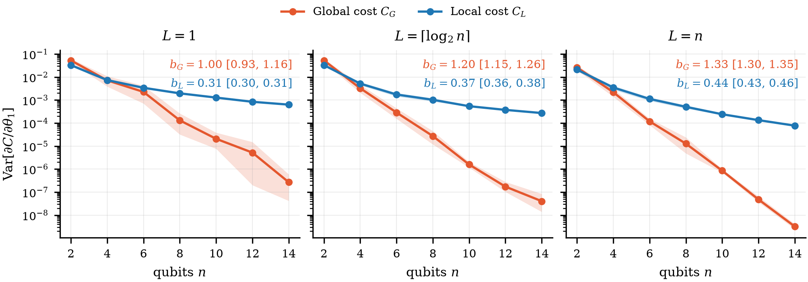

# Barren Plateaus: Global vs. Local Cost Functions

AI 631 Quantum Machine Learning, Fall 2026, Project #8 (QNN track)



**Interactive 3D explorer:** open [`figures/landscape_3d.html`](figures/landscape_3d.html)
in a browser. Drag to rotate, press *Play n* to watch the global landscape flatten.
Deep links work for slides, e.g. `landscape_3d.html?n=12&mode=random`.

## Research question

How does the gradient variance of a parameterized quantum circuit scale with
qubit count *n* and depth *L* for **global** and **local** cost functions?
Does a smarter initialization (identity-block or reduced-domain) help? And how
do these effects change the training of a small classifier in noise-free
simulation, under a noise model, and on IBM quantum hardware?

The global cost uses the all-zeros probability, `C_G = 1 - <0^n|ρ|0^n>`.
The local cost averages single-qubit probabilities,
`C_L = 1 - (1/n) Σ_j <0|ρ_j|0>`. Both come from the same Z-basis measurement.

## Week 1 status (Nov 15)

| Deliverable | Where |
|---|---|
| Verified simulator + exact (adjoint) gradients, analytic unit test | `src/bp/sim.py`, `tests/` (22 tests) |
| Data pipeline, fixed folds (NB11 protocol + fold-wise PCA) | `src/bp/data.py`, `data/folds.json` |
| Classical baselines (majority, logistic, tuned RBF-SVM, param-matched MLP) | `experiments/02_classical_baselines.py` |
| First quantum model, global vs. local readout, exact + 2048-shot Aer evaluation (Run A) | `experiments/03_quantum_classifier.py` |
| Shot-noise training, 1024-shot parameter shift vs. exact control (Run B, H4) | `experiments/06_shot_training.py` |
| Label-shuffle leakage checks | `experiments/03_…`, `experiments/05_leakage_check.py` |
| Noise-free gradient-variance sweep, n = 2…14, three depths | `experiments/01_variance_sweep.py` |
| Interactive 3D cost-landscape explorer | `experiments/04_landscape.py`, `viz/make_landscape_html.py` |
| Report: introduction and methods | `report/report.tex` |

Headline numbers are in [`results/week1_summary.md`](results/week1_summary.md).
In brief:

* **H1 supported.** At L = ⌈log₂ n⌉ the fitted decay rate of Var[∂C] is
  b = 1.20 [1.15, 1.26] for the global cost vs. 0.37 [0.36, 0.38] for the
  local cost (95% bootstrap CIs; 2000 parameter draws per point for n ≥ 10,
  because the global gradient is heavy-tailed). At n = 14 the variances differ
  by about 6800×.
* **H2 supported.** The local-cost decay rate rises from 0.37 to 0.44 [0.43, 0.46]
  at L = n (global: 1.20 → 1.33).
* **H4 not supported at n ≤ 8.** Run A (cross-entropy, exact gradients) cannot
  show a plateau: `-log P(0^n)` rescales the global readout's small gradient by
  `1/P`. Run B removes both masks: Brier loss, 1024-shot parameter-shift gradients,
  and an exact-gradient control on the same folds and seeds. At initialization
  the global readout's gradient is 2–5× smaller than the local one (0.008 vs.
  0.040 at n = 6). With a 32-sample batch, the shot estimate still keeps
  98–100% of the true gradient norm. Shot-trained and exact-trained models reach
  the same test AUC (global 0.974 → 0.951, local 0.981 → 0.979 for n = 4 → 8).
  The small global-vs.-local gap appears identically without shot noise, so it is
  not a shot-noise effect. Testing H4 needs larger n or fewer shots (Week 2).
  All quantum models stay below logistic regression, the RBF-SVM and the MLP
  (AUC ≈ 0.99).


## Week 2 status (Nov 22)

| Deliverable | Where |
|---|---|
| Density-matrix simulator with exact adjoint gradients (depolarizing, amplitude damping) | `src/bp/density.py`, `tests/test_density.py` |
| Identity-block circuit `ib_hea` and the three initializations | `src/bp/ansatz.py`, `tests/test_week2.py` |
| H3 part 1: initial gradient variance by initialization, n = 2…14, width ablation | `experiments/07_init_variance.py` |
| H3 part 2: teacher-state training, 10 seeds, shot-noise + exact gradients | `experiments/08_state_training.py`, `src/bp/state_task.py` |
| H4 continued: Run C (n = 10) and Run D (32/128 shots, n = 8) | `experiments/09_shot_training_ext.py` |
| Noise study: n, depth and strength sweeps | `experiments/10_noise_variance.py` |
| IBM `FakeFez` device noise model (Aer density matrix + readout error) | `experiments/11_fake_backend.py` |
| Report: results section draft | `report/report.tex` |

Headline numbers are in [`results/week2_summary.md`](results/week2_summary.md);
a plain-language overview is in [`PROJECT_OVERVIEW.md`](PROJECT_OVERVIEW.md).
In brief:

* **H1/H2 refit over the pre-registered n = 4…14** (Week 1 included n = 2):
  b_G = 1.17 vs. b_L = 0.29 at L = ⌈log₂ n⌉; at L = n, 1.33 vs. 0.37. Same conclusions.
* **H3, variance criterion not met.** At n ≥ 10, identity blocks raise the initial
  global-cost variance by 1.5–2.5× and reduced-domain starts by 1.1–1.3×, far
  from the pre-registered 10×. The target overlap itself is exponentially small.
* **H3, training criterion not met.** On the teacher-state task (10 seeds) neither
  start trains faster at n = 10 (1024-shot gradients) or n = 12 (exact); all
  Mann–Whitney p ≥ 0.36. At these sizes the global cost trains as well as the local
  one, because the shot noise of P(0ⁿ) shrinks with P itself.
* **H4, pre-registered falsifier not triggered, but the gap is not a plateau effect.**
  At n = 10 (Run C) the local readout's test AUC exceeds the global one's by
  +0.029 [0.016, 0.042] (paired, > 1 s.d.). The gap is the same with exact
  gradients (+0.026), both readouts learn equally fast, and cutting the budget to
  32 shots (Run D, n = 8) barely changes either readout. It is a readout-capacity
  difference, not slower training.
* **Noise.** At shallow depth, 1% two-qubit noise removes at most 20% of the
  variance; the global/local gap is orders of magnitude larger. In deep circuits
  (n = 6, L = 12), depolarizing noise removes 67% (global) and 53% (local).
* **FakeFez.** Variances stay within 15% of noiseless up to n = 8. The 4096-shot
  floor is ≥ 180× below the signal at n ≤ 6, so the Week 3 hardware run is feasible.


## Repository layout

```
src/bp/            library: simulator, ansatz & costs, data, baselines, classifier, Qiskit circuits, plot style
experiments/       00 folds · 01 variance sweep · 02 baselines · 03 quantum classifier (Run A)
                   04 landscape · 05 leakage check · 06 shot-noise training (Run B)
                   07 init variance · 08 teacher-state training · 09 Runs C/D
                   10 noise variance · 11 FakeFez noise model
viz/               figure scripts (matplotlib), the 3D explorer generator, week2_summary.py
tests/             simulator, density-matrix, pipeline and shot-gradient tests (Qiskit/Aer
                   cross-checks, finite differences, parameter shift, closed form)
data/folds.json    the one fold object used by every table
results/           CSV outputs + week1_summary.md, week2_summary.md
                   (results/cache/ holds per-run checkpoints; not committed)
figures/           PDF/PNG figures + landscape_3d.html
report/            IEEE report (report.tex, refs.bib)
synopsis/          initial project synopsis
run_all.py         runs every experiment and figure script in order
```

## Reproduce

```
py -3.14 -m venv .venv
.venv\Scripts\python -m pip install -r requirements.txt
.venv\Scripts\python -m pip install -e .
.venv\Scripts\python -m pytest
.venv\Scripts\python run_all.py              # everything; Week 2 adds ~1 day on 16 threads
.venv\Scripts\python run_all.py --skip-slow  # skip 01, 03, 06–09, rebuild figures from results/
```

Approximate times (16 logical cores): the variance sweep (01) takes ~2 h,
dominated by n = 14 with 2000 draws. Run A (03) takes ~20 min and Run B (06)
~25 min. Week 2: 07 ~1 h, 10 and 11 ~30 min each; 08 (teacher-state training)
~5 h and 09 (Runs C/D) ~14 h, dominated by 1024-shot parameter-shift training at
n = 10. Both write a checkpoint per finished run to `results/cache/` and resume
from it when restarted; `BP_WORKERS` sets the number of worker processes.
Everything else takes a minute or less. One seed constant (`bp.SEED = 0`);
every experimental constant is in `src/bp/config.py`. GitHub Actions runs the
test suite on Python 3.12 and 3.14.

## Building the report

`report/report.tex` uses IEEEtran, TikZ with the `quantikz2` library, and BibTeX
(`refs.bib`), and reads figures from `../figures/`. On Overleaf, upload
`report/` and `figures/` with the same layout. Locally:
`pdflatex report && bibtex report && pdflatex report && pdflatex report`, or
`tectonic report.tex` (XeTeX; the preamble then switches to TeX Gyre Termes,
because IEEEtran's Times has no Unicode shapes).

## Timeline

| Due | Milestone |
|---|---|
| Nov 8 | Initial project synopsis |
| Nov 15 | Week 1: pipeline, folds, classical baselines, first quantum model |
| Nov 22 | Week 2: full simulator results, noise model, ablations |
| Nov 29 | Week 3: IBM hardware results |
| Dec 6 | Final report, presentation, tagged release |

## Author

Saif ur Rehman
